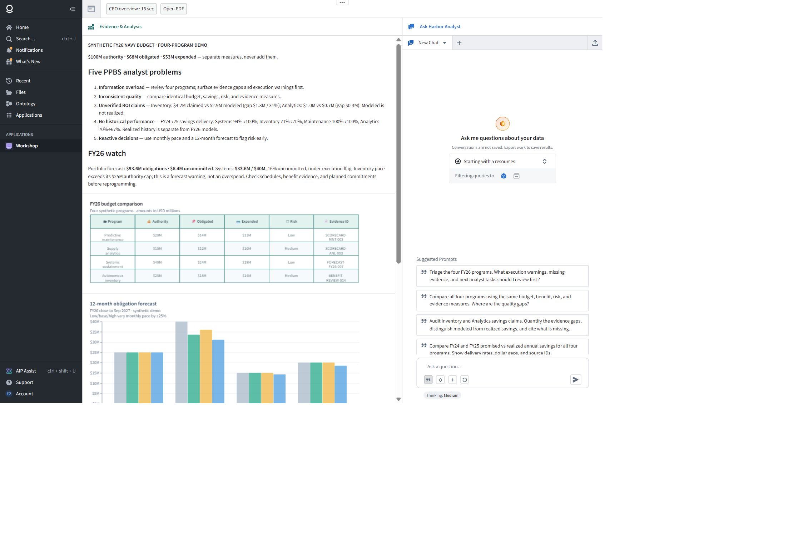

# Harbor — Navy Budget Workspace

A Palantir Foundry Workshop and AIP project for reviewing Navy budget evidence, comparing programs, forecasting execution, and developing cited analyst recommendations.

**All records are synthetic demo data.** The figures illustrate an analyst workflow and do not represent actual Navy budgets or operational information.

## Project overview

Harbor brings budget measures, supporting evidence, historical performance, and execution forecasts into one workspace. Its analyst prompts address five problems:

- Information overload: triage execution warnings and evidence gaps across four programs.
- Inconsistent review quality: compare the same budget, benefit, risk, and evidence measures.
- Unverified savings claims: separate claimed, modeled, and realized benefits.
- Missing historical context: compare FY24 and FY25 promised versus realized savings.
- Reactive decisions: use monthly actuals and 12-month forecasts to surface risk early.

## Demo portfolio

FY26 snapshot shown in the application; amounts are USD.

| Program | Budget authority | Obligated | Expended | Delivery risk | Primary evidence |
| --- | ---: | ---: | ---: | --- | --- |
| Systems sustainment | $40,000,000 | $24,000,000 | $18,000,000 | Low | FORECAST-FY26-007 |
| Autonomous inventory | $25,000,000 | $18,000,000 | $14,000,000 | Medium | BENEFIT-REVIEW-014 |
| Predictive maintenance | $20,000,000 | $14,000,000 | $11,000,000 | Low | SCORECARD-MNT-003 |
| Supply analytics | $15,000,000 | $12,000,000 | $10,000,000 | Medium | SCORECARD-ANL-003 |
| **Total** | **$100,000,000** | **$68,000,000** | **$53,000,000** | | |

Authority, obligations, and expenditures are separate measures; they must not be added together.

The application highlights a $93.6M portfolio obligation forecast and $6.4M uncommitted. Systems sustainment has a $33.6M forecast against $40M authority, with a 16% uncommitted under-execution flag. Inventory demand exceeds its $25M authority cap in the pace forecast; this is a forecast warning rather than an actual overspend.

Inventory's $4.2M claimed annual savings exceed its $2.9M modeled savings by $1.3M (31% of the claim). Analytics shows $1.0M claimed versus $0.7M modeled. Modeled savings are not realized savings.

## Foundry components

The Workshop editor lists six ontology types:

- Harbor Program Budget
- Harbor Evidence
- Harbor Execution Forecast
- Harbor Performance Period
- Harbor Budget Scenario
- Harbor Recommendation

The project folder includes supporting demo datasets, an executive overview PDF media set, evidence and performance links, scenario links, and a **Save Harbor Recommendation** action.

## Analyst workflow

1. Review the portfolio summary and execution warnings.
2. Select a program and inspect its properties and linked evidence.
3. Ask Harbor Analyst to compare programs, audit savings claims, review historical delivery, or explain forecast scenarios.
4. Check supporting source IDs and distinguish actuals from forecasts.
5. Review funding scenarios and save cited recommendations within Foundry.

Example prompt:

> Audit Inventory and Analytics savings claims. Quantify the evidence gaps, distinguish modeled from realized savings, and cite what is missing.

## Access and repository scope

[Open Harbor in Foundry](https://afc-build.usw-22.palantirfoundry.com/workspace/module/view/latest/ri.workshop.main.module.40147875-6e0a-4367-b816-ce7bcfa2ce53)

The live application requires access to its Foundry environment. The inspected published Workshop version is **v0.12.0**.

This repository documents and showcases the existing Foundry project. It includes a workspace screenshot and a CSV transcription of the visible four-program budget table. It does not contain an exported Workshop configuration, complete datasets, or a standalone deployable application.

Documentation captured on October 3, 2026.
